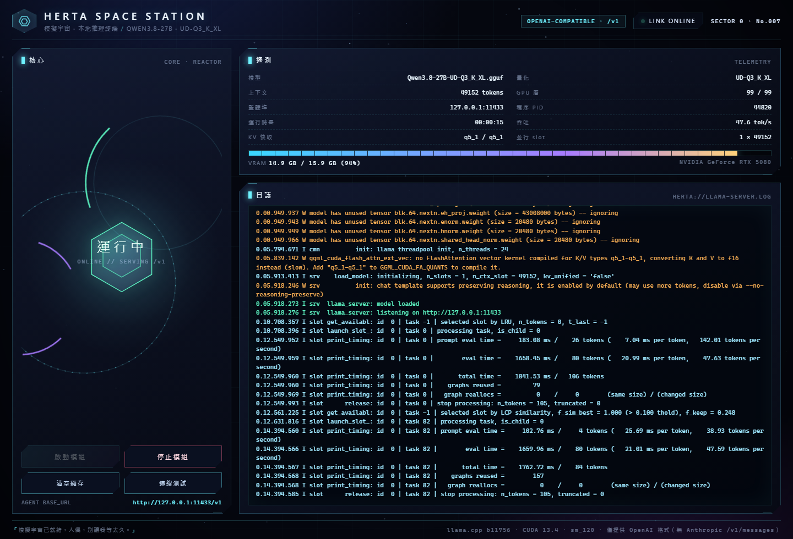
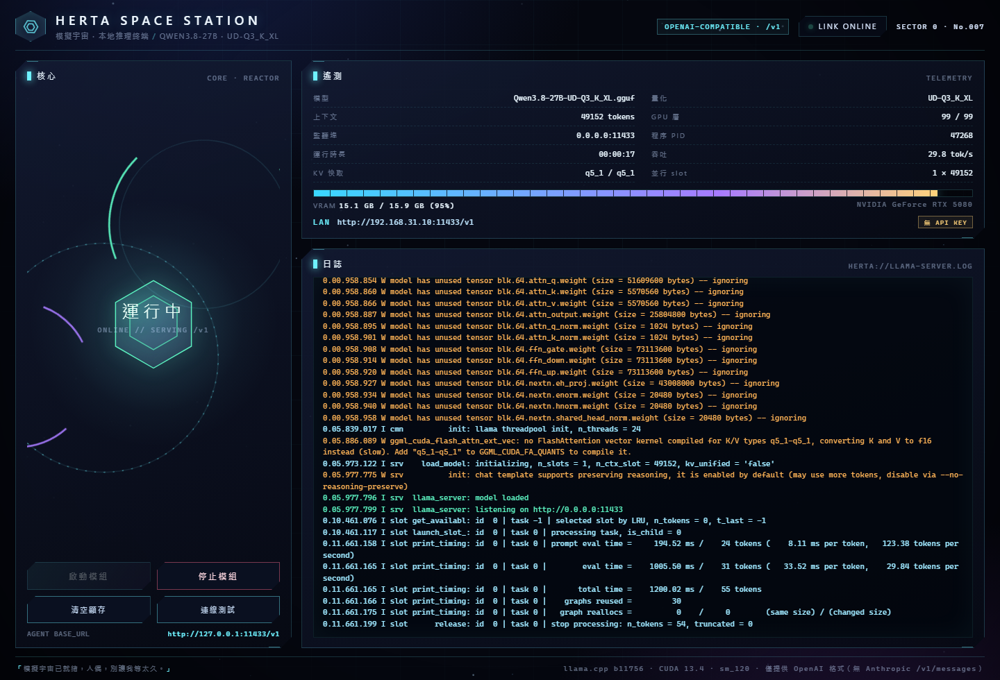
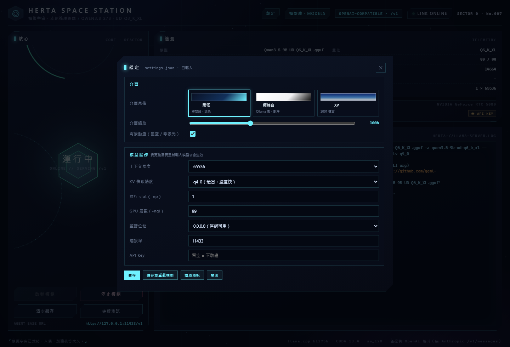
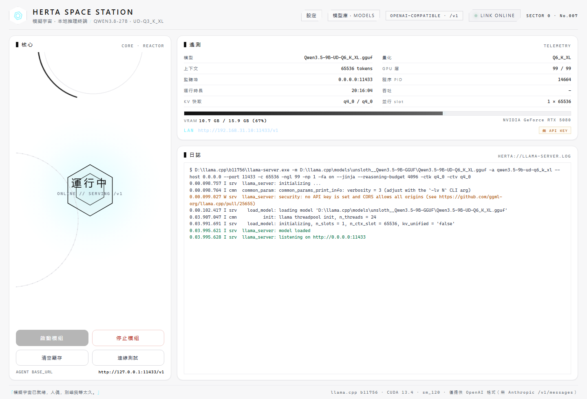
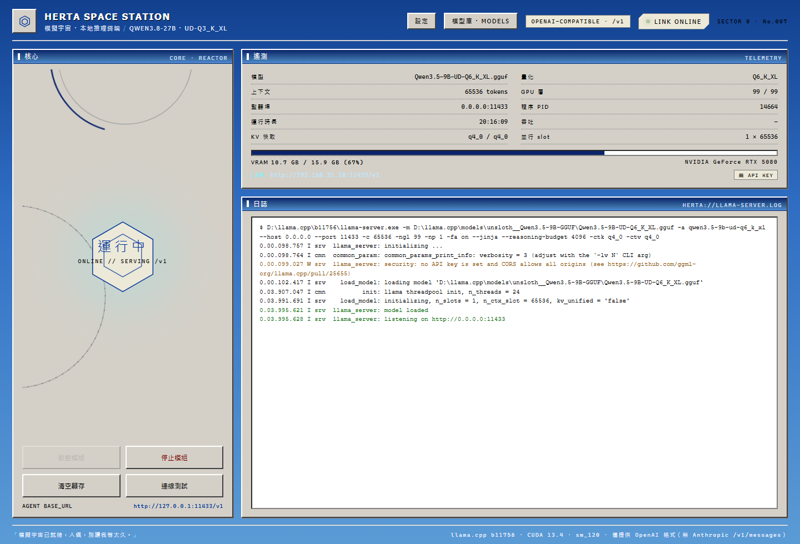
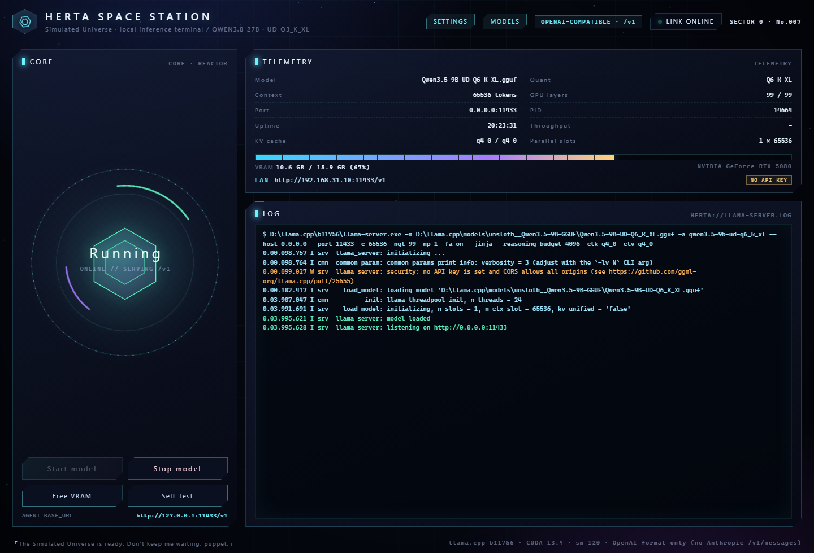
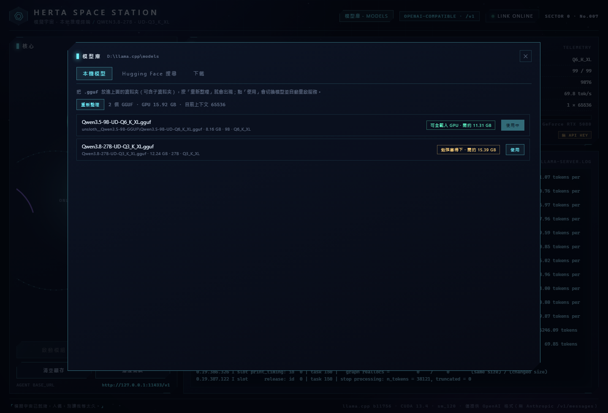
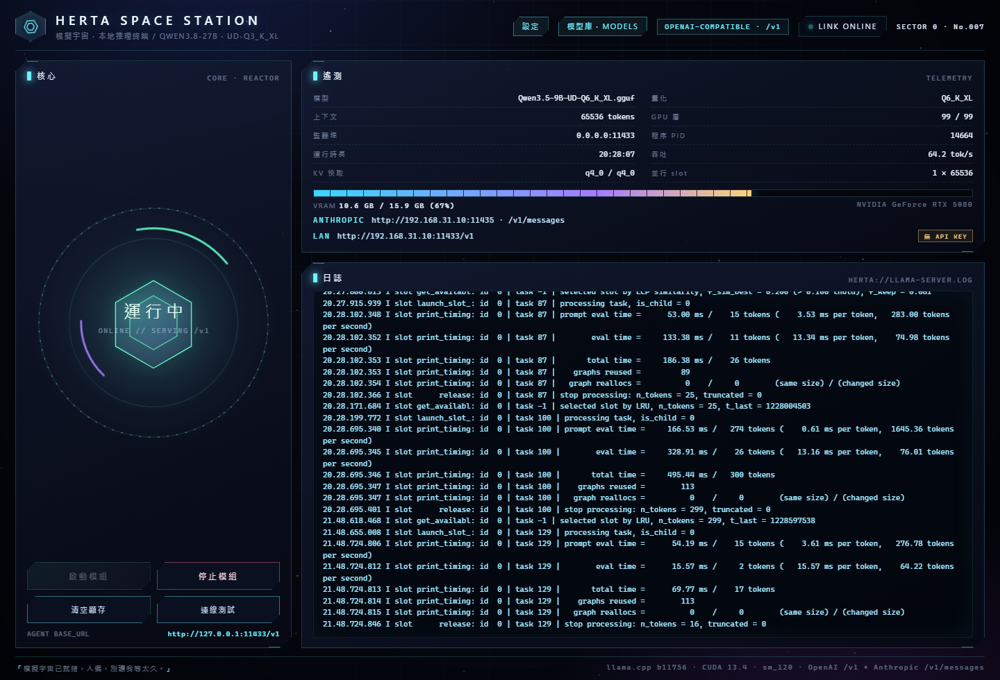

# Herta Station

A single-file Windows app that starts/stops a local **llama.cpp** server and shows its state in a Herta Space Station styled window — VRAM, PID, context, KV cache type, throughput, and the live `llama-server` log.

The model API it exposes is plain **OpenAI-compatible** (`/v1/chat/completions`), so any agent/client can point at it — locally or over the LAN — while the GUI remains the only place that can start or stop the server.



## Why this exists

Running a 27B model on a 16 GB card through Ollama left ~30 % of the layers on the CPU. Swapping to `llama-server` with a manual GGUF, a tuned context size and a quantized KV cache put everything on the GPU — and made the "is it loaded, how much VRAM is it eating, kill it now" loop a two-button GUI instead of a terminal.

## Features

- **Start / stop** the model with one click; stopping really frees VRAM.
- **Purge** button also unloads every Ollama model so the two never fight over memory.
- **Self-test** sends one tiny chat request and reports latency + reply.
- **Telemetry**: model file, quant, context, GPU layers, KV cache type, PID, uptime, tokens/s, VRAM bar.
- **Live log** of `llama-server` with warning/error colouring.
- **Model library**: scans a `models/` folder for GGUF files, shows fit/VRAM estimates, and hot-swaps the active model.
- **Hugging Face search** built in: search any model name, filter by vendor / parameter count / quantisation, list the repo's GGUF files with sizes, and download one straight into the library (progress bar, auto-selects when done).
- **OpenAI-compatible endpoint** on `0.0.0.0:11433` and an **Anthropic Messages** shim (`/v1/messages`) on `0.0.0.0:11435` — both LAN reachable, optional bearer key; the control plane stays on `127.0.0.1:8899`.
- **Settings panel**: UI zoom 80–135 %, background animation toggle, and the launch parameters (context, KV precision, parallel slots, GPU layers, bind address, port, API key) — saved to `settings.json` and applied on the next model load.
- Ships as a **12 MB one-file EXE** (PyInstaller + pywebview/WebView2) — no Python, no browser tab.



## Settings



Click **設定** in the header (or open `http://127.0.0.1:8899/#settings`).

| Group | Fields |
| --- | --- |
| 介面 | **theme** (黑塔 / 極簡白 / Windows XP), **language** (繁體中文 / 简体中文 / English), UI zoom (80–135 %, previewed live as CSS zoom), background animation on/off |
| 模型服務 | context length, KV cache precision (f16 / q8_0 / q5_1 / q4_0), parallel slots (`-np`), GPU layers (`-ngl`), bind address, port, API key |

- Everything is stored in `settings.json` next to the EXE; the panel wins over the environment variables, which stay as first-run defaults.
- Changing anything under 模型服務 needs a model reload — the panel says so and offers **儲存並重載模型**.
- **還原預設** writes the built-in defaults back.
### Themes

Three skins, picked in 設定 → 介面風格, applied instantly and stored in settings.json:

| Theme | Look |
| --- | --- |
| **黑塔** (default) | dark space station, neon cyan/violet, starfield, reactor core |
| **極簡白** | white cards, grey hairlines, black accents — the Ollama-style minimal look |
| **Windows XP** | XP blue gradient desktop, grey 3-D panels, gradient title bars, Tahoma, beveled buttons |



### Languages

The interface ships in 繁體中文 (default), 简体中文 and English — switch it in 設定 → 語言 / Language, or set ui.lang in settings.json (zh-Hant, zh-Hans, en).

Static labels are translated through a keyed dictionary; dynamic text (status, counters, recommendation lines) goes through the same dictionary via a 	(key, vars) helper, so switching re-renders the live panels instead of leaving stale strings behind.




## Model library



Click **模型庫 · MODELS** in the header. Three tabs:

| Tab | What it does |
| --- | --- |
| 本機模型 | Scans every `*.gguf` under the models folder (default `<exe dir>\models`, override with `HERTA_MODELS_DIR`) into a table with **separate columns for name, size, parameters, quantisation and VRAM verdict**. **使用** swaps the model and restarts the server (~10–30 s). |
| Hugging Face 搜尋 | Searches `huggingface.co/api/models?filter=gguf`. **Vendor chips work on their own** — click Qwen/DeepSeek/Llama/Gemma/Mistral/GLM with an empty box and it lists that vendor's GGUF repos by downloads (80 rows); typing a keyword narrows it. Parameter bucket (≤4B, 7–9B, 13–14B, 27–32B, 70B+) and quantisation (Q4–Q8) chips filter the result set. Diffusion / video / TTS repos are filtered out. Each repo expands to its GGUF files with size + fit estimate. |
| 下載 | Live download progress (percent, GB, MB/s), cancel button. A finished download is written to `models/<owner>__<repo>/` and becomes the active model. |

Dropping a `.gguf` in by hand works too — hit **重新整理**.
Handy shortcut: opening `http://127.0.0.1:8899/#models` jumps straight into the library.

The default model is whatever `HERTA_MODEL` points at until you pick one in the library; the choice is stored next to the EXE in `active-model.json`.
### Runtime recommendation

The **本機建議** card is computed on every open from the hardware it finds — nothing is hard-coded per machine, so it adapts to whatever GPU the user has:

1. VRAM is read from `nvidia-smi`; if that is missing it falls back to `Win32_VideoController` (AMD/Intel).
2. Context overhead is derived from the configured context: `1.9 GB buffers + ctx/1000 × 0.019 GB KV`.
3. The weight budget is `VRAM × 0.965 − overhead` (a hard ceiling tier uses `× 0.99`).
4. Quant density is measured (GB per billion params): Q8_0 0.99, Q6_K 0.77, Q5_K_M 0.68, Q4_K_M 0.59, Q3_K_XL 0.455, Q2_K_XL 0.37.
5. Three tiers come out of that: **建議** (largest size class that still fits at Q4_K_M or better), **品質上限** (bigger model pushed down to Q3, right against the limit) and **速度** (same size at Q4_K_M).

Example on a 16 GB RTX 5080 at 64k context: weights budget 12.21 GB → 14B Q6_K (10.78 GB) recommended, 27B Q3_K_XL (12.29 GB) as the quality ceiling, 14B Q4_K_M (8.26 GB) for speed.


## Requirements

- Windows 10/11
- [WebView2 runtime](https://developer.microsoft.com/microsoft-edge/webview2/) (preinstalled on current Windows)
- A `llama-server.exe` build (CUDA/Vulkan/CPU) and a GGUF model
- For building: Python 3.11+, `pip install -r requirements.txt`

## Quick start

```bat
set HERTA_LLAMA_EXE=C:\llama.cpp\llama-server.exe
set HERTA_MODEL=D:\models\Qwen3.8-27B-UD-Q3_K_XL.gguf
set HERTA_ALIAS=local-model
python herta_app.py
```

Or build the EXE:

```powershell
.\build.ps1
```

and run `dist\HertaStation.exe`.

The EXE reads the same environment variables; anything unset falls back to the defaults in `server.py`.

## Configuration

| Variable | Default | Meaning |
| --- | --- | --- |
| `HERTA_LLAMA_EXE` | `D:\llama.cpp\b11756\llama-server.exe` | `llama-server.exe` path |
| `HERTA_MODEL` | `D:\ollama-gguf\qwen3.8-27b\Qwen3.8-27B-UD-Q3_K_XL.gguf` | GGUF weights |
| `HERTA_MMPROJ_PATH` | `…\mmproj-F16.gguf` | vision projector file |
| `HERTA_MMPROJ` | `0` | `1` loads the projector (costs ~0.9 GB VRAM) |
| `HERTA_ALIAS` | derived from file name | model name reported by `/v1/models` |
| `HERTA_MODELS_DIR` | `<exe dir>\models` | folder the library scans |
| `HERTA_CTX` | `65536` | context length |
| `HERTA_PARALLEL` | `1` | parallel slots (`-np`) |
| `HERTA_FA` | `on` | flash attention |
| `HERTA_CTK` / `HERTA_CTV` | `q4_0` | KV cache types |
| `HERTA_BIND` | `0.0.0.0` | listen address (`127.0.0.1` = local only) |
| `HERTA_PORT` | `11433` | model API port |
| `HERTA_API_KEY` | empty | when set, clients must send `Authorization: Bearer …` |

## API

```
Base URL : http://127.0.0.1:11433/v1      (or http://<lan-ip>:11433/v1)
Model    : value of HERTA_ALIAS
```

```bash
curl http://127.0.0.1:11433/v1/chat/completions \
  -H "Content-Type: application/json" \
  -d '{"model":"qwen3.8-27b-q3xl","messages":[{"role":"user","content":"hi"}]}'
```

Endpoints come from `llama-server`: `/v1/models`, `/v1/chat/completions`, `/v1/completions`, `/health`, `/props`, `/slots`, plus llama.cpp's own web UI at `/`.
There is no Anthropic `/v1/messages` route.

Thinking models usually put reasoning in `message.reasoning_content`; pass `"chat_template_kwargs": {"enable_thinking": false}` to get a plain answer only.

When you expose the endpoint on a LAN, only the model port is reachable — 8899 (start/stop) stays bound to loopback.
### Anthropic Messages API

llama.cpp only speaks the OpenAI dialect, so the app runs a small shim that accepts Anthropic requests and translates them (including SSE streaming, tool use and thinking) onto the local model:

```
Base URL : http://127.0.0.1:11435        (LAN: http://<lan-ip>:11435)
POST     : /v1/messages, /v1/messages/count_tokens
Auth     : x-api-key or Authorization: Bearer — only enforced when HERTA_API_KEY is set
```

```bash
curl http://127.0.0.1:11435/v1/messages \
  -H "content-type: application/json" -H "x-api-key: local" \
  -d '{"model":"local","max_tokens":128,"messages":[{"role":"user","content":"hi"}]}'
```

Point Claude Code (or any Anthropic SDK) at it:

```bat
set ANTHROPIC_BASE_URL=http://127.0.0.1:11435
set ANTHROPIC_API_KEY=local
```

- 	hinking: {type: "enabled", budget_tokens: N} maps onto the model's reasoning effort (low/medium/high); without it thinking is switched off, so plain clients get plain answers.
- Tool definitions (	ools[].input_schema) become OpenAI function tools, and 	ool_calls come back as 	ool_use blocks with parsed JSON input.
- Turn it off or change the port in 設定 → Anthropic /v1/messages.




## The 16 GB VRAM cliff (RTX 5080, Qwen3.8-27B Q3_K_XL)

`llama-server` silently collapses to ~1/10 speed once total VRAM passes ≈15.3 GB on a 16 GB card — unrelated to parameter count or KV precision:

| ctx | KV | VRAM | generation |
| ---: | --- | ---: | ---: |
| 8192 | q8_0 | 14.8 GB | 44 tok/s |
| 24576 | q8_0 | 15.5 GB | 42 tok/s |
| 32768 | q8_0 | 15.4 GB | 19.7 tok/s |
| 49152 | q5_1 | 15.25 GB | 47 tok/s |
| 49152 | q8_0 | 15.7 GB | **3.1 tok/s** |
| **65536** | **q4_0** | **15.33 GB** | **45 tok/s** (38 tok/s at 38k context) |
| 81920 | q4_0 | 15.59 GB | 25 tok/s |
| 98304 | q4_0 | 15.69 GB | 5 tok/s |
| 131072 | q4_0 | 15.73 GB | 1.3 tok/s |

### Picking a model for 16 GB

Same card, same 64k context, two models that both stay fully on the GPU:

| model | weights | VRAM | prefill (38k prompt) | generation (short / 38k) |
| --- | ---: | ---: | ---: | ---: |
| Qwen3.8-27B UD-Q3_K_XL | 12.24 GB | 15.4 GB | 1.6k tok/s | 48 / 40 tok/s |
| **Qwen3.5-9B UD-Q6_K_XL** | **8.16 GB** | **10.4 GB** | **5.2k tok/s** | **81 / 70 tok/s** |

The 9B leaves ~5.5 GB of headroom, so it never touches host memory and answers ~2× faster; the 27B is the quality option and sits right at the VRAM cliff.
That is why the defaults are `-c 65536 -ctk q4_0 -ctv q4_0`: the largest context that still stays under the cliff on a 16 GB card, and the vision projector stays off unless asked for. Keeping the KV cache in RAM (`-nkvo`) does allow 131072, but generation at long context collapses to ~2 tok/s, so it is not a win.

`q5_1` KV is a little more precise but has no native flash-attention kernel in current builds (the log tells you to compile `q5_1-q5_1` into `GGML_CUDA_FA_QUANTS`), and at 64k it pushes VRAM over the cliff — `q4_0` is both faster and smaller here.

## Layout

```
herta_app.py          entry point: control server + WebView2 window
server.py             control plane: start/stop/purge/selftest/status + llama-server supervision
ui.html               the interface (single file, no CDN, no build step)
assets/herta.ico      app icon
scripts/make_icon.py  regenerates the icon
scripts/start-server.bat / stop-server.bat   CLI-only equivalents
build.ps1             PyInstaller one-file build
```

## License

MIT — see [LICENSE](LICENSE).
